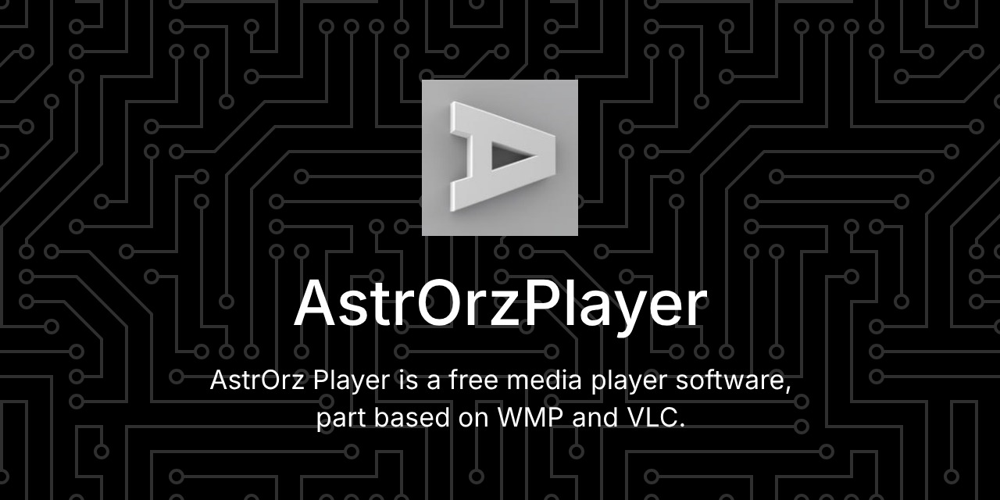

**その他の言語版:[English](README.md)、[中文](README_zh.md)、[日本語](README_jp.md)、プレビュー画像:[Screenshot](screenshot/).**
# AstrOrzPlayer ReadMe
このソフトウェア(AstrOrz Player)は非商用であり、すべてのライブラリのライセンスに準拠しています。 
ライブラリは変更されておらず、ライブラリの接続にはリンクモードのみが使用されます。 
## Astrorz プレイヤーについて
AstrOrz Playerは、WMPとVLCを一部ベースにした無料のメディアプレーヤーソフトウェアです。 
プレーヤーはミニマルなスタイルで、10色以上のテーマカラーがあり、カスタマイズも可能です。クイックフォルダ開きとm3uに対応しています。 
ほとんどの音声・動画フォーマットを再生できます。音楽プレーヤーやビデオプレーヤーとしても使えます。 
プレイヤーは最初に多数のファイル(数千個)を開くと、2回目には素早く開きます。 
## 著者注
著者はWMPを気に入っていますが、WMPはもはや更新されていません。最初は音楽プレーヤーとして始まり、徐々にビデオプレーヤーへと発展しました。 
著者はAstrOrz Playerを使って音楽を再生することを楽しんでおり、誰もが音楽プレーヤーとして使えることを願っています。音楽プレーヤーはビデオプレーヤーでもあります。 
このプレーヤーはWMPに似た操作感を目指しており、Windowsシステムとの互換性も高いです。 
このプレーヤーはAndroidのFolder Playerにインスパイアされており、フォルダをかなりうまく再生できます。 
簡素化のため、著者は複雑なメディアライブラリ管理を行っていませんでした。 
## ランタイム
Windows(x64)、.NET 4.6.2、Windows Media Player。 
## 多言語
AstrOrz Playerは、英語、中国語、日本語、ドイツ語、フランス語、イタリア語、スペイン語、ポルトガル語、ロシア語、韓国語の10言語に対応しています。
## ありがとうございます
AstrOrz Playerの誕生は以下の要因と密接に関連しています: 
VLC MediaPlayer、MahApp。Metro、BoxIcons、SQLite、Dapper、TagLibSharp、 
C#.Net、WPF、Visual Studio、Microsoft、およびWindows Media Player。 
## 注記
バージョン2.2以降は、プレーヤーのインターフェースは主にWindows 11に対応しています。Windows 10を使用している場合は、タイトルバーに合ったテーマカラーを選択してください。 
## このプレイヤーは何ができるのか? 
これは音楽と動画のプレーヤーです。音楽や動画を再生するために使えます。 
フォルダやM3Uファイルを自動的にドロップダウンリストに保存できるので、次回プレイリストをすぐに開けます。 
ファイルやフォルダを直接ドラッグして再生することもできます。 
## セキュリティについて
このプログラムのコードには難読化がされており、ウイルス対策ソフトに誤検出される可能性があります。
このソフトは INI ファイルと SQLite データベースへの書き込みのみをサポートしており、これらのファイルはすべてプログラムフォルダ内にあります。他のファイルは読み取り専用です。
注意：バージョン2.0には既知の問題があります。もしPCに GPU-Tweak-III や一部の特殊なソフトがインストールされている場合、動画再生時にフラッシュバックが発生することがあります。
現在のところ原因は不明ですが、GPU-Tweak-III を無効化またはアンインストールすると動画再生に問題はありません。
## 誤検出について
このプログラムのコードは難読化されており、ウイルス対策ソフトに誤検出される可能性があります。
フォルダを開けない場合は、ウイルス対策ソフトでホワイトリストに追加してください。
「ショートカット」を作成してからその名前を変更すると、クラッシュする場合があります。
ファイルを直接実行ファイルにドラッグするとクラッシュする場合がありますが、「ショートカット」にドラッグすれば大丈夫です。
クラッシュを引き起こす可能性のあるソフト（例：GPUTweakIII）があります。
（上記の問題は通常、ウイルス対策ソフトや Windows のセキュリティ機能によって発生します）
## 公開ページ
https://github.com/astroLIU/AstrOrzPlayer/ 
## 使い方
左クリックで下部のプレイヤーアイコンをクリックしてファイルを開きます。 
下部のプレイヤーアイコンを右クリックしてメニューを開きます。 
プレイリストを右クリックするとメニューを開くこともできます。 
右クリックのポップアップメニューを使ってファイルやフォルダーを追加します。 
再生用にファイルやフォルダをドラッグしてプレーヤーに移動することもできます。 
開いたフォルダやM3Uファイルはプレイリストのドロップダウンボックスに保存されるので、次にプレイリストを開くときはより速くなります。 

動画を再生する際、右クリックしてオーディオトラックや字幕を選択できます
(音声トラックと字幕が含まれている場合)
動画再生時、Ctrl ← キーと Ctrl → キーで進行状況を1%増減します。
バージョン2.1の新機能:動画再生時に右クリックメニューから再生速度を選択できます
(0.25x、0.5x、0.75x、1x、1.25x、1.5x、2x)
バージョン2.2追加:ビデオ再生時に全画面に切り替え、Escキーを2回押して全画面を終了、再生を一時停止、フルスクリーン再生中にウィンドウを最小化します。 
Esc キーを押すことでウィンドウステート再生が一時停止され、最小化されます。 

## ショートカット
前へ(Ctrl ← または P)、次へ(ctrl → または n)、ボリューム(ctrl ↑ / ctrl ↓)、再生/一時停止(スペース)
ビデオ全画面表示(Enter キー | ダブルクリック)、ビデオ(Ctrl ← / ctrl →)は 1% のステップです
次のフレーム(Alt →)、スクリーンショット(Alt S)(Capフォルダ内のスクリーンショット)
フルスクリーンモードでEscキーを2回押してフルスクリーンを終了し、一時停止、最小化します。ウィンドウモードでプレイ中にEscを2回押し、一時停止、最小化します。
